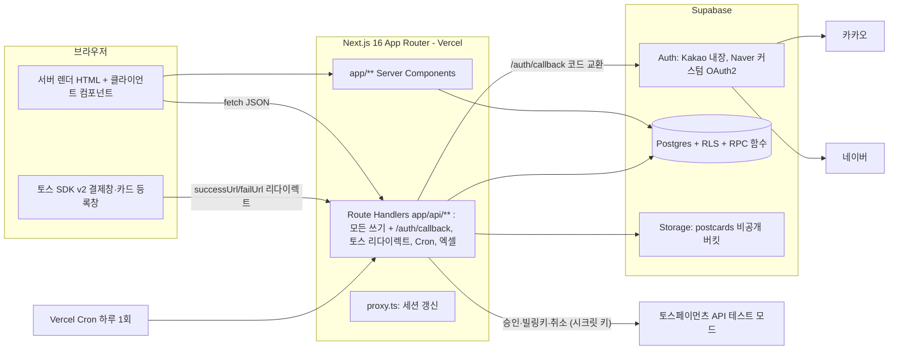

# 02. 시스템 아키텍처 (AR-SYS)

- 근거: `01-drivers.md` (DRV-C, DRV-Q, RISK), ADR-001~005
- ADR-001~005 모두 Accepted (2026-10-21).

## 1. 구성도

## 2. 책임 분담 (ADR-002)
| 위치 | 하는 일 | 하지 않는 일 |
|---|---|---|
| Server Components (`app/**/page.tsx`) | 읽기: 데이터 접근 함수 호출 → 화면 렌더 | 쓰기, 토스 호출, 자기 API fetch |
| Route Handlers (`app/api/**/route.ts`) | 모든 쓰기(회원·관리자), OAuth 콜백, 토스 success/fail 리다이렉트, Cron, 엑셀 파일 응답 | 화면 렌더 |
| Postgres RPC (`security definer`) | 여러 테이블을 한 번에 바꾸는 트랜잭션: 결제 확정, 주문 취소, 구독 시작, 회차 열기, 발송, 언박싱 | 외부 HTTP |
| `proxy.ts` | Supabase 세션 쿠키 갱신 | 권한 판단 (권한은 Route Handler·데이터 접근 계층과 RLS에서) |
| Server Actions | 쓰지 않음 | — |

## 3. 기술 스택
| 영역 | 선택 | 버전 | 선택 이유 | ADR |
|---|---|---|---|---|
| 프레임워크 | Next.js App Router | 16.4.2 (설치됨) | KANT 고정, 이미 설치 | DRV-C-02 |
| UI 런타임 | React | 19.3.0 (설치됨) | Next 16 짝 | — |
| 언어 | TypeScript strict | ^5 (설치됨) | KANT 고정 | — |
| 스타일 | Tailwind CSS | ^4 (설치됨) | KANT 고정 | — |
| UI 부품 | shadcn(base-ui) `components/ui/*`, lucide-react | 설치됨 | 이미 있는 버튼·카드·다이얼로그 재사용 | — |
| DB·인증·파일 | Supabase (`@supabase/ssr`, `@supabase/supabase-js`, `supabase` CLI) | 설치됨 | 팀 고정 | DRV-C-01 |
| 결제 | 토스페이먼츠 SDK v2 `@tosspayments/tosspayments-sdk` | ^2.9.0 (**추가**) | 사용자 이전 작업과 같은 SDK, 단건 결제창 + 카드 등록창 | ADR-004 |
| 호스팅·스케줄 | Vercel + Vercel Cron | — | Next 16 기본 배포 대상, 하루 1회 자동결제 실행 | ADR-005 |
| 입력 검증 | (A4에서 ADR) | — | — | ADR-007 예정 |
| 테스트 | (A7에서 ADR) | — | — | ADR-009 예정 |
| 엑셀 | (A4에서 결정) | — | — | ADR-008 예정 |

## 4. 외부 연동
| 대상 | 방식 | 테스트 | 근거 |
|---|---|---|---|
| 카카오 로그인 | Supabase Auth 커스텀 provider `custom:kakao` (D-041) | 카카오 개발자 앱 + Redirect URI 등록 | ADR-003 |
| 네이버 로그인 | 서버가 직접 처리 `/api/auth/naver/*` → magiclink 토큰으로 Supabase 세션 (D-042, B안) | 네이버 개발자 앱(개발 중 상태: 등록한 테스트 계정만) | ADR-003, RISK-09 |
| 토스 단건 결제 | SDK `payment().requestPayment()` → `/api/payments/success` → `POST /v1/payments/confirm` | 테스트 키 | ADR-004 |
| 토스 자동결제 | SDK `payment().requestBillingAuth()` → `/api/billing/success` → `POST /v1/billing/authorizations/issue` → `POST /v1/billing/{billingKey}` | 테스트 키 | ADR-004 |
| 토스 환불 | `POST /v1/payments/{paymentKey}/cancel` | 테스트 키 | ADR-004, D-007 |
| 택배사 | 연동 없음 | — | REQ-021 |

## 5. 상태 표시 방식 (→ARCH-06)
- 촛불·창가 상태는 마이페이지를 열 때 서버에서 조회한다. Realtime·폴링은 쓰지 않는다. `[자율][ARCH]` 결정, 근거 Q-020, DRV-C-08, DRV-Q-04.
