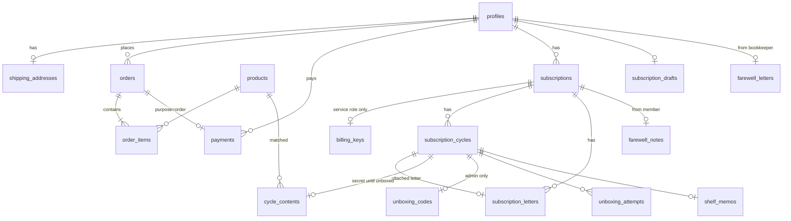

# 03. DB 스키마 (AR-DB)

- 근거: `03-domain.md` §3~§6, ADR-001~005, `01-drivers.md` RISK
- 대상: Supabase Postgres. 마이그레이션은 `supabase/migrations/<YYYYMMDDHHMMSS>_<name>.sql`(Supabase CLI 형식). 번호는 티켓 실행 순서와 같다(이미 적용된 번호보다 앞 번호 파일을 만들지 않는다).
- 이름 규칙: 테이블 snake_case 복수형, 컬럼 snake_case, enum `<name>_status`. 금액은 `integer`(원 단위). 시각은 `timestamptz`, 날짜 계산 기준 시간대는 `Asia/Seoul`.
- 모든 테이블: `enable row level security`. 정책이 없는 동작은 거부된다. `service_role`은 RLS를 우회하므로 서버 전용 코드에서만 쓴다(ADR-005).
- 모든 RPC: `security definer`, `set search_path = ''`, 객체는 스키마를 붙여 쓴다(`public.products`). 회원용 RPC는 `auth.uid()`로 본인을 판정하고 인자로 user id를 받지 않는다.

## 1. ERD


## 2. 엔티티 ↔ 테이블
| ENT | 도메인 이름 | 테이블 | 비고 |
|---|---|---|---|
| ENT-01 | Product | `products` | KANT 5속성 + 도메인 속성 |
| ENT-02 | (회원) | `profiles` | `auth.users` 1:1, `is_admin` (ADR-003) |
| ENT-03 | ShippingAddress | `shipping_addresses` | 회원당 1개 |
| ENT-04 | Order, OrderItem | `orders`, `order_items` | 배송지·가격은 주문 시점 스냅샷 |
| ENT-05 | Payment | `payments` | 단건·회차 공통, 토스 식별자 unique |
| ENT-06 | (빌링키) | `billing_keys` | 정책 0개 → service role만 |
| ENT-07 | Subscription | `subscriptions` | 회원당 활성 1개 |
| ENT-08 | SubscriptionCycle | `subscription_cycles` | 창가 상태 = 회차 상태 |
| ENT-09 | SubscriptionLetter | `subscription_letters` | `cycle_id is null` = 보관 편지 |
| ENT-10 | BookMatch, ReplyLetter, PostcardPhoto | `cycle_contents` | 언박싱 전 회원 조회 불가 (INV-01) |
| ENT-11 | Teaser | `subscription_cycles.teaser` | 회원에게 보이는 유일한 책 정보 |
| ENT-12 | UnboxingCode | `unboxing_codes`, `unboxing_attempts` | 회원 조회 불가 (INV-04) |
| ENT-13 | ShelfMemo | `shelf_memos` | 관리자도 조회 불가 (INV-11) |
| ENT-14 | (구독 신청 임시 편지) | `subscription_drafts` | 카드 등록 리다이렉트 동안 편지 보관 |
| ENT-15 | FarewellLetter | `farewell_letters` | 책방지기 → 회원. 없으면 코드 상수 기본 편지 |
| ENT-16 | FarewellNote | `farewell_notes` | 회원 → 책방지기 |
| — | Cart | (DB 없음) | 브라우저 `localStorage` (§6 `[자율][ARCH]`) |

## 3. DDL

### 3.1 확장·enum (`20261021000001_enums.sql`, TKT-DB-01)
```sql
create extension if not exists pgcrypto with schema extensions;

create type public.theme as enum ('nature', 'food', 'ecology', 'local');
create type public.order_status as enum ('pending_payment', 'paid', 'shipped', 'cancelled', 'refunded');
create type public.payment_status as enum ('ready', 'confirmed', 'failed', 'refunded');
create type public.payment_purpose as enum ('order', 'subscription_cycle');
create type public.subscription_status as enum ('active', 'cancelled', 'ended');
create type public.cycle_status as enum ('awaiting_letter', 'letter_arrived', 'reading', 'shipped', 'unboxed');

create function public.set_updated_at() returns trigger language plpgsql as $$
begin new.updated_at = now(); return new; end $$;
```
- 이후 `updated_at`이 있는 모든 테이블에 `before update ... execute function public.set_updated_at()` 트리거를 단다.

### 3.2 회원 (`20261021000003_profiles.sql`, TKT-DB-02)
```sql
create table public.profiles (
  id uuid primary key references auth.users (id) on delete cascade,
  display_name text not null default '',
  is_admin boolean not null default false,
  created_at timestamptz not null default now(),
  updated_at timestamptz not null default now()
);

-- auth.users insert 시 profiles 생성 (display_name = raw_user_meta_data의 name → nickname → '')
create function public.handle_new_user() returns trigger
  language plpgsql security definer set search_path = '' as $$ ... $$;
create trigger on_auth_user_created after insert on auth.users
  for each row execute function public.handle_new_user();

create function public.is_admin() returns boolean
  language sql stable security definer set search_path = '' as $$
  select coalesce((select p.is_admin from public.profiles p where p.id = auth.uid()), false)
$$;

create table public.shipping_addresses (
  user_id uuid primary key references public.profiles (id) on delete cascade,
  recipient_name text not null check (char_length(recipient_name) between 1 and 50),
  phone text not null check (phone ~ '^01[0-9]-?[0-9]{3,4}-?[0-9]{4}$'),
  postal_code text not null check (postal_code ~ '^[0-9]{5}$'),
  address1 text not null check (char_length(address1) between 1 and 200),
  address2 text not null default '' check (char_length(address2) <= 100),
  consented_at timestamptz not null,
  created_at timestamptz not null default now(),
  updated_at timestamptz not null default now()
);
```

### 3.3 상품 (`20261021000002_products.sql`, TKT-DB-01)
```sql
create table public.products (
  id uuid primary key default gen_random_uuid(),
  name text not null check (char_length(name) between 1 and 200),
  author text not null,
  publisher text not null,
  theme public.theme not null,
  price integer not null check (price >= 0),
  image_url text not null,
  description text not null,
  bookkeeper_note text not null,
  stock_quantity integer not null default 0 check (stock_quantity >= 0),   -- INV-08
  created_at timestamptz not null default now(),
  updated_at timestamptz not null default now()
);
create index products_theme_idx on public.products (theme);
-- 관리자는 재고만 수정 (D-006)
revoke update on public.products from authenticated, anon;
grant update (stock_quantity) on public.products to authenticated;
```

### 3.4 주문·결제 + 주문 RPC (`20261021000004_orders_payments.sql`, TKT-DB-03)
```sql
create table public.orders (
  id uuid primary key default gen_random_uuid(),
  user_id uuid not null references public.profiles (id) on delete restrict,
  status public.order_status not null default 'pending_payment',
  items_amount integer not null check (items_amount >= 0),
  shipping_fee integer not null check (shipping_fee >= 0),
  total_amount integer not null check (total_amount = items_amount + shipping_fee and total_amount > 0),
  order_name text not null,                         -- 결제창 표시용 "책이름 외 n건"
  ship_recipient_name text not null, ship_phone text not null,
  ship_postal_code text not null, ship_address1 text not null, ship_address2 text not null,
  paid_at timestamptz, shipped_at timestamptz, refunded_at timestamptz,
  created_at timestamptz not null default now(),
  updated_at timestamptz not null default now(),
  check (status <> 'paid' or paid_at is not null),
  check (status <> 'shipped' or (paid_at is not null and shipped_at is not null)),   -- INV-05
  check (status <> 'refunded' or (paid_at is not null and shipped_at is null and refunded_at is not null))  -- INV-18
);
create index orders_user_idx on public.orders (user_id, created_at desc);
create index orders_status_idx on public.orders (status, paid_at);

create table public.order_items (
  id uuid primary key default gen_random_uuid(),
  order_id uuid not null references public.orders (id) on delete cascade,
  product_id uuid not null references public.products (id) on delete restrict,
  product_name text not null,
  unit_price integer not null check (unit_price >= 0),
  quantity integer not null check (quantity between 1 and 99),
  unique (order_id, product_id)
);

create table public.payments (
  id uuid primary key default gen_random_uuid(),
  user_id uuid not null references public.profiles (id) on delete restrict,
  purpose public.payment_purpose not null,
  order_id uuid references public.orders (id) on delete restrict,
  subscription_id uuid,                              -- FK는 3.5에서 추가
  cycle_no integer,
  toss_order_id text not null unique check (toss_order_id ~ '^[A-Za-z0-9_-]{6,64}$'),  -- RISK-01, NFR-08
  payment_key text unique,                           -- 토스 paymentKey, 승인 후 채움
  amount integer not null check (amount > 0),
  status public.payment_status not null default 'ready',
  method text,
  approved_at timestamptz, refunded_at timestamptz,
  failure_code text, failure_message text,
  created_at timestamptz not null default now(),
  updated_at timestamptz not null default now(),
  check ((purpose = 'order' and order_id is not null and subscription_id is null)
      or (purpose = 'subscription_cycle' and order_id is null and subscription_id is not null and cycle_no >= 1)),
  check (status <> 'confirmed' or (payment_key is not null and approved_at is not null))
);
create unique index payments_order_once on public.payments (order_id) where purpose = 'order';
create unique index payments_cycle_once on public.payments (subscription_id, cycle_no) where purpose = 'subscription_cycle';  -- RISK-03
```
- 토스 `orderId` 규칙: 단건 `ord_<orders.id에서 하이픈 뺀 32자>`, 회차 `sub_<subscriptions.id 32자>_<cycle_no>`. 회차 결제 ID가 결정적이라 같은 달 두 번 결제가 토스·DB 양쪽에서 막힌다.
- 카드번호 등 민감 결제 정보는 저장하지 않는다. `method`는 토스 응답의 수단 이름(예: `카드`, `간편결제`)만.

### 3.5 구독 (`20261021000005_subscriptions.sql` + `20261021000006_storage_postcards.sql`, TKT-DB-04 / RPC는 `20261021000007_rpc_subscriptions.sql` TKT-DB-05, `20261021000008_rpc_cycles.sql` TKT-DB-06)
```sql
create table public.subscriptions (
  id uuid primary key default gen_random_uuid(),
  user_id uuid not null references public.profiles (id) on delete restrict,
  status public.subscription_status not null default 'active',
  monthly_price integer not null check (monthly_price > 0),
  billing_day smallint not null check (billing_day between 1 and 31),   -- 신청일 (D-003)
  next_billing_date date,                                                -- active일 때만 값 (D-021 말일 보정)
  started_at timestamptz not null default now(),
  cancelled_at timestamptz, ended_at timestamptz,
  end_reason text check (end_reason in ('payment_failed')),
  created_at timestamptz not null default now(),
  updated_at timestamptz not null default now(),
  check ((status = 'active') = (next_billing_date is not null)),          -- INV-19
  check (status <> 'cancelled' or cancelled_at is not null),
  check (status <> 'ended' or (ended_at is not null and end_reason is not null))
);
create unique index subscriptions_one_active on public.subscriptions (user_id) where status = 'active';  -- INV-17
create index subscriptions_billing_idx on public.subscriptions (next_billing_date) where status = 'active';
alter table public.payments add foreign key (subscription_id) references public.subscriptions (id) on delete restrict;

create table public.billing_keys (
  subscription_id uuid primary key references public.subscriptions (id) on delete cascade,
  customer_key uuid not null,          -- = profiles.id (토스 customerKey)
  billing_key text not null,
  created_at timestamptz not null default now()
);   -- RLS on, 정책 없음 (RISK-08)

create table public.subscription_drafts (
  user_id uuid primary key references public.profiles (id) on delete cascade,
  letter_body text not null check (char_length(letter_body) between 1 and 2000),   -- D-023
  created_at timestamptz not null default now(),
  updated_at timestamptz not null default now()
);

create table public.subscription_cycles (
  id uuid primary key default gen_random_uuid(),
  subscription_id uuid not null references public.subscriptions (id) on delete restrict,
  user_id uuid not null references public.profiles (id) on delete restrict,   -- RLS 단순화용 중복
  cycle_no integer not null check (cycle_no >= 1),
  status public.cycle_status not null,
  payment_id uuid not null unique references public.payments (id) on delete restrict,   -- INV-05
  teaser text check (char_length(teaser) between 1 and 100),                 -- D-024
  reading_started_at timestamptz, shipped_at timestamptz, unboxed_at timestamptz,
  created_at timestamptz not null default now(),
  updated_at timestamptz not null default now(),
  unique (subscription_id, cycle_no),
  check (status not in ('reading', 'shipped', 'unboxed') or reading_started_at is not null),
  check (status not in ('shipped', 'unboxed') or (shipped_at is not null and teaser is not null)),   -- INV-15
  check (status <> 'unboxed' or unboxed_at is not null)
);
create index cycles_user_idx on public.subscription_cycles (user_id, cycle_no desc);
create index cycles_status_idx on public.subscription_cycles (status, created_at);

create table public.subscription_letters (
  id uuid primary key default gen_random_uuid(),
  subscription_id uuid not null references public.subscriptions (id) on delete restrict,
  user_id uuid not null references public.profiles (id) on delete restrict,
  cycle_id uuid unique references public.subscription_cycles (id) on delete restrict,   -- null = 보관 편지
  body text not null check (char_length(body) between 1 and 2000),
  created_at timestamptz not null default now(),
  updated_at timestamptz not null default now()
);
create unique index letters_one_stored on public.subscription_letters (subscription_id) where cycle_id is null;   -- D-027

create table public.cycle_contents (
  cycle_id uuid primary key references public.subscription_cycles (id) on delete restrict,
  product_id uuid references public.products (id) on delete restrict,
  reply_letter text check (char_length(reply_letter) between 1 and 2000),   -- D-024
  postcard_path text,                                                        -- Storage postcards 버킷 경로 (D-025: 1장)
  updated_at timestamptz not null default now()
);

create table public.unboxing_codes (
  cycle_id uuid primary key references public.subscription_cycles (id) on delete restrict,
  code char(6) not null check (code ~ '^[0-9]{6}$'),
  issued_at timestamptz not null default now(),
  redeemed_at timestamptz
);
create unique index unboxing_codes_unique_unredeemed on public.unboxing_codes (code) where redeemed_at is null;   -- INV-02

create table public.unboxing_attempts (
  id bigint generated always as identity primary key,
  user_id uuid not null references public.profiles (id) on delete cascade,
  cycle_id uuid not null references public.subscription_cycles (id) on delete cascade,
  succeeded boolean not null,
  attempted_at timestamptz not null default now()
);
create index unboxing_attempts_user_idx on public.unboxing_attempts (user_id, attempted_at desc);

create table public.shelf_memos (
  cycle_id uuid primary key references public.subscription_cycles (id) on delete cascade,
  user_id uuid not null references public.profiles (id) on delete cascade,
  body text not null check (char_length(body) between 1 and 100),   -- D-017
  created_at timestamptz not null default now(),
  updated_at timestamptz not null default now()                    -- 화면 표시 날짜 (Q-009)
);

create table public.farewell_letters (
  user_id uuid primary key references public.profiles (id) on delete cascade,
  body text not null check (char_length(body) between 1 and 2000),
  created_at timestamptz not null default now(),
  updated_at timestamptz not null default now()
);

create table public.farewell_notes (
  subscription_id uuid primary key references public.subscriptions (id) on delete restrict,
  user_id uuid not null references public.profiles (id) on delete restrict,
  body text not null default '' check (char_length(body) <= 2000),   -- D-018 빈 글 허용
  created_at timestamptz not null default now()
);
```

## 4. RLS 정책
표기: ✔ = 허용(조건), — = 정책 없음(거부). `own` = `user_id = auth.uid()`(profiles는 `id = auth.uid()`). `admin` = `public.is_admin()`. RPC는 `security definer`라 이 표와 별개로 함수 안에서 권한을 검사한다.

| 테이블 | anon select | 회원 select | 회원 insert | 회원 update | 회원 delete | admin select | admin insert/update/delete |
|---|---|---|---|---|---|---|---|
| profiles | — | own | — (트리거) | — | — | ✔ | — |
| shipping_addresses | — | own | own | own | — | ✔ | — |
| products | ✔ | ✔ | — | — | — | ✔ | update(`stock_quantity`만, 컬럼 권한) |
| orders | — | own | — (RPC) | — (RPC) | — | ✔ | — (RPC `admin_ship_order`) |
| order_items | — | 소속 주문이 own | — | — | — | ✔ | — |
| payments | — | own | — | — | — | ✔ | — |
| billing_keys | — | — | — | — | — | — | — (service role만) |
| subscriptions | — | own | — (RPC) | — (RPC) | — | ✔ | — |
| subscription_drafts | — | own | own | own | own | — | — |
| subscription_cycles | — | own | — | — | — | ✔ | — (RPC) |
| subscription_letters | — | own | — (RPC) | — (RPC `update_letter`) | — | ✔ | — |
| cycle_contents | — | 소속 회차가 own **이고 `status = 'unboxed'`** (INV-01) | — | — | — | ✔ | — (RPC) |
| unboxing_codes | — | — (INV-04) | — | — | — | ✔ | — (RPC) |
| unboxing_attempts | — | — | — | — | — | — | — (RPC만 기록) |
| shelf_memos | — | own | own 이고 회차가 `unboxed` | own | own | **—** (INV-11, AC-20-6) | — |
| farewell_letters | — | own | — | — | — | ✔ | insert/update: admin, 대상 회원에게 `active` 구독이 있을 때 (AC-23-3) |
| farewell_notes | — | — | — (RPC) | — | — | ✔ | — |

- `subscription_cycles`는 회원에게 보여도 되는 컬럼만 있다(teaser 포함). 책·답장·엽서는 `cycle_contents`에만 있다.
- `unboxing_codes`는 회원 정책이 없으므로 회원이 어떤 경로로도 코드를 읽을 수 없다. 대조는 RPC 안에서만.

## 5. RPC 함수 (트랜잭션 경계, ADR-002)
| 함수 | 호출자 (키) | 권한 검사 | 하는 일 | 실패 시 |
|---|---|---|---|---|
| `create_pending_order(p_items jsonb)` → `(order_id, toss_order_id, amount, order_name)` | 회원 (publishable + 세션) | `auth.uid()` 필수, 배송지 존재 | 상품 가격·재고 확인(재고 < 수량이면 예외 `OUT_OF_STOCK`), 금액 계산(배송비 상수 §7), 배송지 스냅샷, `orders`(pending) + `order_items` + `payments`(ready) 생성 | 예외 → 전부 롤백 |
| `confirm_order_payment(p_toss_order_id, p_payment_key, p_amount, p_method, p_approved_at)` → `order_id` | 서버 (service role) | — (서버 전용, `grant execute ... to service_role`만) | `payments`가 `ready`이고 금액 일치일 때만 `confirmed`, 주문 `paid`, 재고 차감 `update products set stock_quantity = stock_quantity - q where id = ... and stock_quantity >= q` (영향 행 0이면 예외 `OUT_OF_STOCK`). 이미 같은 `payment_key`로 `confirmed`면 그대로 성공 반환(멱등) | 예외 → 롤백, 서버가 토스 취소(보상) |
| `fail_order_payment(p_toss_order_id, p_code, p_message)` | 서버 | 서버 전용 | `ready` → `failed`, 주문 `pending_payment` → `cancelled` | — |
| `refund_order(p_order_id, p_refunded_at)` | 서버 | 서버 전용 (Route가 본인·`paid` 확인 후 토스 취소 성공 뒤 호출) | 주문 `paid` → `refunded`, 결제 `refunded`, 재고 복구. 이미 `refunded`면 그대로 성공 | 예외 → 롤백 (토스는 이미 환불됨 → 오류 로그, 재시도 시 멱등) |
| `admin_ship_order(p_order_id)` | 관리자 | `is_admin()` | `paid` → `shipped` (조건부, 0행이면 예외 `INVALID_STATE`) | — |
| `start_subscription(p_subscription_id, p_user_id, p_customer_key, p_billing_key, p_toss_order_id, p_payment_key, p_amount, p_method, p_approved_at, p_billing_day, p_next_billing_date)` → `subscription_id` | 서버 | 서버 전용 | 활성 구독 없음 확인, `subscriptions` + `billing_keys` + `payments`(confirmed, cycle 1) + 회차 1(`letter_arrived`) 생성, `subscription_drafts`의 편지를 회차 1 편지로 옮기고 draft 삭제 | 예외 → 롤백, 서버가 토스 결제 취소(보상) |
| `open_cycle(p_subscription_id, p_cycle_no, p_toss_order_id, p_payment_key, p_amount, p_approved_at, p_next_billing_date)` → `cycle_id` | 서버 (Cron) | 서버 전용 | 구독 `active` 확인(`for update`), 다음 `cycle_no`, 보관 편지가 있으면 붙이고 `letter_arrived`, 없으면 `awaiting_letter`, `next_billing_date` 갱신 | 예외 → 롤백, 토스 취소 |
| `end_subscription_payment_failed(p_subscription_id, p_cycle_no, p_toss_order_id, p_amount, p_code, p_message)` | 서버 (Cron) | 서버 전용 | `active` → `ended`(`payment_failed`), `next_billing_date = null`, 실패 결제 기록 | — |
| `submit_letter(p_body text)` → `{ attached_cycle_id \| null }` | 회원 | `auth.uid()`, 본인 `active` 구독 | D-014: `reading` 이전(`awaiting_letter`)인 가장 이른 회차에 편지가 없으면 붙이고 회차를 `letter_arrived`로. 없으면 보관 편지 생성(이미 있으면 내용 수정) | 예외 `NO_ACTIVE_SUBSCRIPTION` |
| `update_letter(p_letter_id, p_body)` | 회원 | 본인, 붙은 회차가 `letter_arrived`이거나 보관 편지 | 내용 수정 (D-027) | 예외 `INVALID_STATE` |
| `admin_start_reading(p_cycle_id)` | 관리자 | `is_admin()` | `letter_arrived`·`awaiting_letter` → `reading`, `reading_started_at = now()`, `cycle_contents` 빈 행 생성 | 0행 → `INVALID_STATE` |
| `admin_save_cycle_content(p_cycle_id, p_product_id, p_reply_letter, p_postcard_path, p_teaser)` | 관리자 | `is_admin()`, 회차 `reading` | 각 인자가 null이 아니면 갱신. `p_product_id`는 재고 ≥ 1이어야 함 | `OUT_OF_STOCK`, `INVALID_STATE` |
| `admin_ship_cycle(p_cycle_id)` → `code` | 관리자 | `is_admin()` | 회차 `reading` + 책·답장·힌트 존재 확인(INV-15), 재고 1 차감(조건부), 코드 생성(`extensions.gen_random_bytes` 기반 6자리, 미사용 코드와 충돌 시 재생성 최대 10회), `shipped`. **이미 `shipped`면 기존 코드를 반환**(멱등, AC-18-5) | `OUT_OF_STOCK`, `MISSING_CONTENT`, `INVALID_STATE` |
| `redeem_unboxing_code(p_cycle_id, p_code)` → `{ ok, remaining_attempts, locked_until }` | 회원 | `auth.uid()`가 회차 주인, 회차 `shipped` | 잠금 확인: 최근 10분 안 실패 ≥ 5회(마지막 성공 이후)면 `locked_until` 반환. 코드 대조 → 성공: `redeemed_at`, 회차 `unboxed`, 시도 기록 / 실패: 시도 기록, 남은 횟수 반환. 다른 회원의 회차 ID면 실패와 같은 응답(AC-19-8) | — (결과로 반환) |
| `cancel_subscription(p_note text)` | 회원 | `auth.uid()`, 본인 `active` 구독 | `active` → `cancelled`, `next_billing_date = null`, `farewell_notes` 생성. 이미 `cancelled`면 그대로 성공 | `NO_ACTIVE_SUBSCRIPTION` |

| `audit_rls()` → `table (table_name, rls_enabled, policy_count)` | 서버 (GATE-07) | 서버 전용 | `pg_class`·`pg_policies`에서 `public` 테이블별 RLS 여부·정책 수 | — |

- 예외는 `raise exception using errcode = 'P0001', message = '<CODE>'`로 던지고, 앱은 message를 에러 코드로 매핑한다(`04-interfaces-api.md` 에러 모델).
- 서버 전용 함수: `revoke execute on function ... from public, anon, authenticated; grant execute ... to service_role;`

## 6. Storage
| 버킷 | 공개 | 경로 규칙 | 정책 |
|---|---|---|---|
| `postcards` | 비공개 | `cycles/<cycle_id>/postcard.<jpg\|png\|webp>` | insert/update/select/delete: `is_admin()` / select: 회원 — 경로의 `cycle_id` 회차가 본인 것이고 `status = 'unboxed'` |
- 업로드 제한: 5MB 이하, `image/jpeg`, `image/png`, `image/webp` (버킷 `file_size_limit`, `allowed_mime_types`로 설정). AC-17-4
- 회원 화면은 서명 URL(유효 1시간)을 서버에서 만들어 내려준다. 공개 URL은 쓰지 않는다.
- 상품 이미지는 Storage를 쓰지 않는다(ADR-001, 원격 URL).

### `[자율][ARCH]` 장바구니는 DB에 두지 않는다
- 장바구니는 브라우저 `localStorage`(`ubb-cart-v1`: `{ productId, quantity }[]`)에만 둔다. 가격·재고·금액은 서버가 `create_pending_order`에서 다시 계산한다. 같은 브라우저에서 로그인 전후로 유지된다(D-026). 근거: DRV-Q-04, 테이블·RLS 1개 감소.

## 7. 상수·seed
- 배송비, 구독료: 임시 금액(Q-013). DB 함수와 화면이 같은 값을 써야 하므로 `public.app_constants()` SQL 함수 하나에 둔다: `shipping_fee = 3000`, `subscription_monthly_price = 18000`, `free_shipping_threshold = 30000` (모두 "예시"). 책 금액이 `free_shipping_threshold` 이상이면 `create_pending_order`가 배송비를 0으로 둔다(D-039). 화면은 이 값을 데이터 계층으로 읽는다.
- 기본 마지막 인사 편지(Q-022): 코드 상수(위치는 `05-structure-conventions.md`), "예시" 표시.
- seed: `data/products.ts`(6개 이상, 4개 테마에 고루) → `scripts/gen-seed.ts` → `supabase/seed.sql`(생성물, 직접 수정 금지). 관리자 지정은 seed에 넣지 않는다(실제 계정 id가 필요) — README에 SQL 한 줄 안내: `update public.profiles set is_admin = true where id = '<uuid>';`
- 타입: `npx supabase gen types typescript --linked > types/database.ts` (DB-TYPES). KANT `types/product.ts`와의 변환 함수는 한 곳(`05-structure-conventions.md`)에만 둔다.

## 8. INV ↔ DB 보장 위치
| INV | DB에서 막는 방법 | 앱에서도 하는 일 |
|---|---|---|
| INV-01 | `cycle_contents` RLS(`unboxed`만), Storage 정책 | 회원 화면 데이터 함수가 `cycle_contents`를 조인하지 않음 |
| INV-02 | `unboxing_codes_unique_unredeemed`, `redeem_unboxing_code` 본인 회차 확인 | — |
| INV-03 | `redeem_unboxing_code` 잠금 (5회/10분) | 남은 횟수·잠금 시각 표시 |
| INV-04 | `unboxing_codes` 회원 정책 없음 | — |
| INV-05 | `orders` check, `subscription_cycles.payment_id not null unique` | — |
| INV-06 | `confirm_order_payment` 금액 비교 | Route가 토스 승인 전 금액 대조 |
| INV-07 | `payments.toss_order_id/payment_key unique`, 상태 조건부 | — |
| INV-08 | `check (stock_quantity >= 0)`, 조건부 차감 | 화면 품절 표시 |
| INV-09 | 회차 `reading`은 `admin_start_reading`만 | 열람 API는 상태를 바꾸지 않음 |
| INV-10 | RPC가 기대 상태에서만 전이, check 제약 | — |
| INV-11 | RLS own, `shelf_memos` admin 정책 없음 | — |
| INV-12 | `cancel_subscription` 단일 호출 | 화면에 경고·확인 단계 없음 (앱 규칙) |
| INV-13 | `is_admin()` 정책·RPC 검사 | `/admin`·`/api/admin/**` 진입 시 확인 |
| INV-14 | 주소록은 admin select 정책 + 관리자 Route | — |
| INV-15 | `subscription_cycles` check + `admin_ship_cycle` 검사 | 버튼 비활성 |
| INV-16 | 주문·구독 RPC가 `auth.uid()` 요구 | 로그인 리다이렉트 |
| INV-17 | `subscriptions_one_active` | — |
| INV-18 | `orders` check, `refund_order` 조건 | — |
| INV-19 | `subscriptions` check(`active` ↔ `next_billing_date`), `open_cycle` 상태 확인 | Cron 대상 쿼리 `status = 'active'` |
